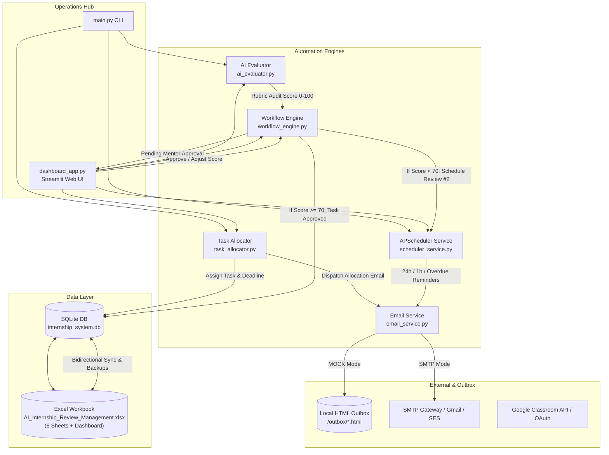
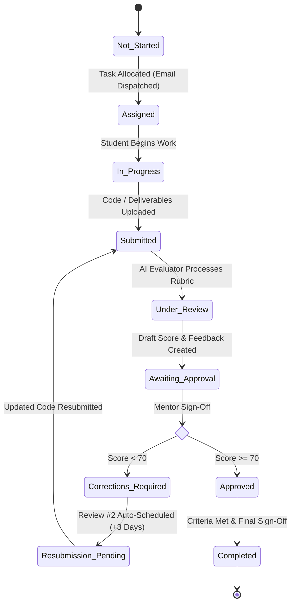

# AI-Powered Internship Task Allocation, Review and Feedback Automation System

An enterprise-grade, Python-based automation engine and interactive management dashboard for orchestrating end-to-end internships for 100+ students. 

The system maintains student records in a professionally formatted Excel workbook (`AI_Internship_Review_Management.xlsx`), automatically allocates tasks based on configured track rules, generates personalized emails, schedules formal reviews with persistent APScheduler jobs, performs AI-assisted rubric evaluations with human-in-the-loop sign-off, and tracks multi-review cycles until task approval and internship graduation.

---

## 1. System Architecture & Workflow



### Multi-Review Iteration State Machine


---

## 2. Excel Workbook: `AI_Internship_Review_Management.xlsx`

The generated Excel workbook contains **6 professionally styled worksheets** utilizing a modern Slate & Indigo theme, Segoe UI typography, explicit Excel formulas, dropdown data validation, and an executive KPI dashboard.

| Sheet Name | Purpose & Contents |
| :--- | :--- |
| **1. Student Master** | **26 Columns**, 100 sample student records (`STU-001` to `STU-100`). Contains Student ID, Name, Email (`@example-interns.edu`), Dates, Role, Mentor details, Assigned Task ID, Deadlines, Task Status, Current Review #, Next Review Date/Time, GCR Links, AI Feedback summaries, Completion %, and Remarks. Includes dropdown validation for statuses. |
| **2. Task Allocation** | Complete allocation audit trail: Task ID, Title, Description, Student ID, Email, Assigned Date, Deadline, Priority (`High`/`Medium`/`Low`), Required Deliverables, Submission Link, and Email Status. |
| **3. Review Schedule** | Master schedule: Review ID (`REV-STU-xxx-n`), Student ID, Task ID, Review #, Date, Time, Time Zone, Google Meet / GCR Link, Submission Status, Reviewer, and Status (`Scheduled`, `Reminder Sent`, `Completed`, `Missed`). |
| **4. AI Review Feedback** | Granular rubric evaluations: Student ID, Task ID, Review Number, Submission Summary, Rubric Criteria, Identified Mistakes, Missing Requirements, Strengths, Improvement Suggestions, AI Feedback, Score (0-100), Approval Status, and Next Actions. |
| **5. Email Log** | Full dispatch log: Email ID (`EML-xxxx`), Recipient, Email Type, Subject, Timestamp, Delivery Status (`Sent`, `Mock Delivered`, `Failed`), Error Messages, Retry Count, and Related Review ID. |
| **6. Dashboard** | Executive KPI cards calculated dynamically via Excel formulas (`COUNTA`, `COUNTIF`): Total Students, Active Interns, Tasks Assigned, Tasks Completed, Pending Tasks, Overdue Tasks, Reviews Scheduled/Completed/Due Today, Emails Sent/Failed, and Awaiting Feedback. Includes a native **Excel Bar Chart** plotting student counts across internship statuses. |

---

## 3. Project Directory Structure

```
vulture/
├── AI_Internship_Review_Management.xlsx  # 6-sheet formatted workbook with 100 students & dashboard
├── .env.example                          # Configuration template with placeholder credentials
├── .env                                  # Active environment file (default MOCK mode)
├── requirements.txt                      # Python dependencies
├── README.md                             # Comprehensive system documentation
├── main.py                               # Unified CLI automation entrypoint
├── config.py                             # Settings, directories, enums, status constants
├── database.py                           # SQLite schema, WAL mode, ACID transactions & audit logs
├── excel_manager.py                      # OpenPyXL workbook generator, styles & bidirectional sync
├── init_system.py                        # Database seeder & Excel workbook generator
├── task_allocator.py                     # Automatic track matching & manual task allocator
├── scheduler_service.py                  # APScheduler daemon, persistent job store & reminder engine
├── ai_evaluator.py                       # LLM + deterministic rubric evaluator & honesty checks
├── workflow_engine.py                    # Multi-review state machine & completion tracker
├── dashboard_app.py                      # Interactive Streamlit executive web application
├── integrations/
│   ├── __init__.py
│   └── google_classroom.py               # Google Classroom OAuth 2.0 connector & security checks
├── templates/                            # Responsive HTML email templates (Jinja2)
│   ├── base_email.html                   # Master layout with corporate branding
│   ├── task_allocation.html              # Task title, deliverables, deadline, GCR link
│   ├── review_scheduled.html             # Review date, time, meeting URL, checklist
│   ├── review_reminder_24h.html          # 24-hour reminder & submission prompt
│   ├── review_reminder_1h.html           # 1-hour urgent meeting link alert
│   ├── review_feedback.html              # Structured feedback report, score & follow-up date
│   ├── task_completed.html               # Final task approval & graduation notice
│   └── overdue_reminder.html             # Urgent escalation for missed deadlines
├── sample_submissions/                   # Real code files for testing (STU-001 pass, STU-035 fail)
├── outbox/                               # Captured HTML emails in MOCK mode (60+ generated)
├── backups/                              # Automated versioned backups before Excel overwrites
└── tests/
    ├── __init__.py
    ├── test_system.py                    # Unit tests for DB, Excel, Allocator, Email, AI
    └── test_e2e_workflow.py              # Full end-to-end multi-review lifecycle test
```

---

## 4. Installation & Setup

### Prerequisites
- Python 3.10+ (Tested on Python 3.13)
- Windows, macOS, or Linux

### 1. Clone & Enter Directory
```bash
cd vulture
```

### 2. Install Dependencies
```bash
pip install -r requirements.txt
```

### 3. Initialize Database & Generate Excel Workbook
```bash
python init_system.py
```
*This seeds the SQLite database, task catalog, 100 sample students, initial allocations, reviews, feedback history, and creates `AI_Internship_Review_Management.xlsx`.*

---

## 5. Running the System

### Option A: Interactive Web Dashboard (Streamlit)
Launch the full-featured management portal:
```bash
streamlit run dashboard_app.py
```
Open your browser at `http://localhost:8501`.
- **Executive Dashboard**: KPI metrics, task distribution charts, role breakdown.
- **Student Master**: Real-time table of all 100 students with filters by track, task status, and mentor.
- **Task Allocation Hub**: 1-click batch allocation for unassigned interns, manual assignment modal, task catalog.
- **Review & Reminders**: Schedule new reviews, trigger reminder scans, mark missed reviews.
- **AI Evaluation Studio**: Inspect student submissions, run AI rubric evaluation, adjust scores, sign off as mentor, and dispatch feedback.
- **Email Outbox & Logs**: View email dispatch history and live rendered HTML email previews.
- **Audit Trail**: Immutable logs of all administrative actions.

### Option B: CLI Automation Commands
The system can be operated entirely from the terminal or invoked by cron/task schedulers:

| Command | Action |
| :--- | :--- |
| `python main.py --allocate` | Auto-allocates tasks to unassigned students and sends personalized emails. |
| `python main.py --reminders` | Scans all scheduled reviews and sends 24h, 1h, and overdue notices. |
| `python main.py --evaluate STU-001` | Runs AI evaluation on student submission code and outputs report. |
| `python main.py --sync-to-excel` | Exports latest SQLite database state into `AI_Internship_Review_Management.xlsx`. |
| `python main.py --sync-from-excel` | Ingests manual edits made in Excel back into the SQLite database. |
| `python main.py --run-scheduler` | Starts the APScheduler background daemon with persistent SQLite job store. |

---

## 6. Detailed Feature Breakdown

### 1. Automatic Task Allocation (`task_allocator.py`)
- Tracks 6 distinct professional tracks: *AI/ML Engineer*, *Full Stack Web Developer*, *Data Analyst*, *Cloud & DevOps Engineer*, *Mobile App Developer*, *Cybersecurity Specialist*.
- Maps curriculum tasks from `task_catalog` using role matching and load balancing.
- Computes deadlines based on estimated days.
- Dispatches personalized HTML emails containing task title, description, required deliverables, evaluation rubrics, deadline, mentor contact, and GCR submission link.
- **Idempotency & Duplicate Prevention**: Checks existing allocation status; avoids re-sending allocation emails unless `--force-resend` is specified.

### 2. Automated Review Scheduling & Reminders (`scheduler_service.py`)
- Configurable reminder schedule:
  - **Confirmation Email**: Dispatched immediately upon scheduling.
  - **24 Hours Before**: Checks submission status; if unsubmitted, issues an alert to upload deliverables before the meeting.
  - **1 Hour Before**: Urgent alert with direct meeting link.
  - **Overdue Check**: Monitors passing deadlines for unsubmitted tasks and marks status `Overdue`.
- **Persistent Job Store**: Uses `SQLAlchemyJobStore` (`sqlite:///data/internship_system.db`) and `misfire_grace_time=3600` so jobs survive server restarts and catch up missed notifications safely.
- Timezone-aware scheduling configured via `.env` (`TIMEZONE=Asia/Kolkata`).

### 3. AI Review & Feedback Assistant (`ai_evaluator.py`)
- **Dual Engine**:
  - **Cloud LLM Provider**: OpenAI (`gpt-4o-mini`), Google Gemini (`gemini-1.5-flash`), or Anthropic Claude (`claude-3-5-sonnet`) configured via environment variables.
  - **Deterministic Rubric Evaluator**: Robust offline fallback when no API key is set (`LLM_PROVIDER=MOCK`). Analyzes code volume, modular functions, class schemas, exception handling (`try/except`), testing assertions (`pytest`/`unittest`), and secret hygiene.
- **Strict Submission Honesty**: If an external Google Classroom or Drive URL is provided without OAuth authorization, the engine does **not** hallucinate access; it explicitly flags that file upload or OAuth authorization is required.
- **Structured Feedback Format**:
  1. Task completion summary
  2. What was done correctly (Strengths)
  3. Identified mistakes & technical issues
  4. Missing requirements
  5. Recommended corrections & guidance
  6. Score (0–100) with detailed rubric breakdown
  7. Action items before next review
  8. Suggested next review date and time
- **Human-in-the-Loop Approval**: AI evaluation is stored with `reviewer_approval_status = 'Pending Reviewer Approval'`. Mentors can review, adjust score, append notes, and approve before any email is dispatched.

### 4. Next Review Scheduling & Iterative Workflow (`workflow_engine.py`)
- Evaluates approved feedback against `PASSING_SCORE_THRESHOLD` (default: 70/100).
- **If Score < 70**: Task status transitions to `Corrections Required`. Next review (Review #2) is auto-scheduled for +3 days. Student receives detailed feedback report with action items.
- **If Score >= 70**: Task status transitions to `Approved` or `Completed`. Completion percentage updates.
- **Missed Review Handling**: Method `record_missed_review()` marks session as `Missed`, creates a rescheduled review for +2 days, updates student record, and notifies student.

### 5. Separate Task vs Internship Completion
- **Task Completion**: Requires deliverables meeting acceptance criteria and explicit mentor sign-off.
- **Internship Completion**: Requires all mandatory tasks passed, at least 2 formal reviews completed, and overall completion reaching 100%.

---

## 7. Configuration & Environment Variables

Copy `.env.example` to `.env` and configure your settings:

```env
# Timezone & Workflow Policies
TIMEZONE=Asia/Kolkata
PASSING_SCORE_THRESHOLD=70
DEFAULT_REVIEW_INTERVAL_DAYS=3

# Email Transport (MOCK captures to /outbox; SMTP connects to live mail server)
EMAIL_MODE=MOCK
SMTP_HOST=smtp.gmail.com
SMTP_PORT=587
SMTP_USER=admin@example-interns.edu
SMTP_PASSWORD=your_app_password
SMTP_USE_TLS=True
SENDER_NAME="Internship Operations Team"
SENDER_EMAIL=operations@internship-platform.local
EMAIL_MAX_RETRIES=3

# AI Evaluation Engine (MOCK, OPENAI, GEMINI, ANTHROPIC)
LLM_PROVIDER=MOCK
OPENAI_API_KEY=
GEMINI_API_KEY=
ANTHROPIC_API_KEY=
```

---

## 8. Google Classroom OAuth Integration Guide

To connect the system with live Google Classroom coursework:
1. Navigate to the [Google Cloud Console](https://console.cloud.google.com/).
2. Create a project and enable the **Google Classroom API**.
3. Create OAuth 2.0 Credentials (Application Type: **Desktop Application**).
4. Download the client secrets JSON and save it as `credentials.json` in the project root directory.
5. Run the authorization script to complete OAuth consent and generate `token.json`:
   ```bash
   python integrations/google_classroom.py --authorize
   ```
6. Once authorized, the connector can query course submissions using official Google Classroom API scopes (`classroom.coursework.students`, `classroom.student-submissions.students.readonly`).

---

## 9. Verification & Automated Tests

All modules and end-to-end workflows are validated via unit and integration tests:

```bash
python -m pytest tests/ -v
```

### Test Coverage Summary:
- `tests/test_system.py::test_database_initialization`: PASSED (Validates SQLite schema, foreign keys, and audit log tables).
- `tests/test_system.py::test_excel_workbook_sheets_and_formatting`: PASSED (Validates all 6 worksheets, row counts, and Excel formulas).
- `tests/test_system.py::test_task_allocator_idempotency_and_rules`: PASSED (Validates track assignment and duplicate email prevention).
- `tests/test_system.py::test_email_service_rendering_and_mock_capture`: PASSED (Validates Jinja2 rendering and HTML outbox writing).
- `tests/test_system.py::test_ai_evaluator_deterministic_and_cloud_honesty`: PASSED (Validates rubric scoring logic and unauthenticated cloud link guardrails).
- `tests/test_e2e_workflow.py::test_full_student_review_lifecycle_e2e`: PASSED (Simulates complete lifecycle: Allocation -> Review #1 -> Incomplete Code Evaluation -> Corrections Required -> Review #2 Auto-Schedule -> Polished Code Resubmission -> Passing Score Approval -> Task Completed -> Excel Export Sync).

---

## 10. Security & Reliability Highlights

1. **Zero Hardcoded Secrets**: All credentials, tokens, and keys are loaded via `.env`.
2. **Safe Excel Backups**: Every export to `AI_Internship_Review_Management.xlsx` creates a timestamped copy in `/backups/` to prevent data loss.
3. **Database Concurrency & ACID**: SQLite operates in WAL (Write-Ahead Logging) mode with busy timeouts to avoid lock contention.
4. **Email Safety**: `MOCK` mode captures all outgoing emails as rendered HTML files in `/outbox/` for zero risk of sending emails to sample student addresses.
5. **Audit Logging**: Every task allocation, review schedule, evaluation, approval, and missed meeting is recorded with timestamps and user identifiers in `audit_logs`.
